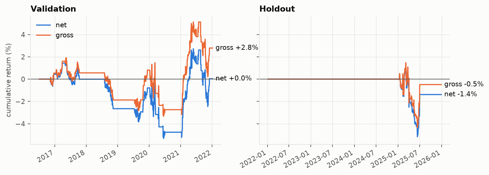
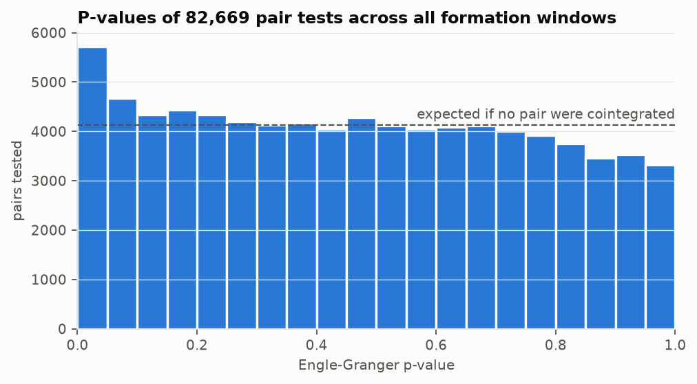
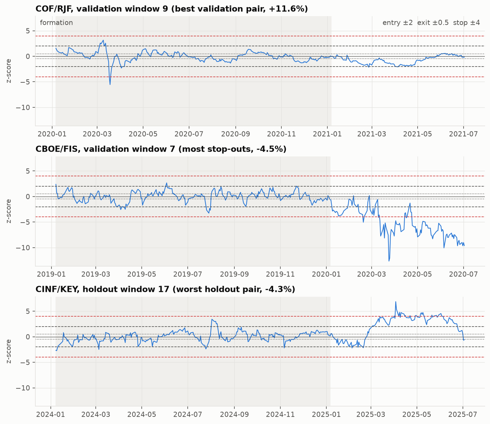

# Statistical Arbitrage: Cointegrated Pairs on the S&P 500

This project backtests a pairs-trading strategy on S&P 500 stocks, using cointegration to pick the pairs. Pairs are tested with Engle-Granger, and the Benjamini-Hochberg procedure controls the false discovery rate across thousands of tests at once. Every pair is chosen using only data from before its trading period, in a rolling walk-forward setup. Settings were tuned on 2016–2021, and 2022–2025 was kept as a holdout and run once at the end.

**Result: no edge.** After costs, the strategy roughly breaks even on validation and loses a little on the holdout. The diagnostics below show why: pairs that look cointegrated over a 12-month formation window mostly stop behaving that way once they are traded.

| | Validation (Jul 2016 – Dec 2021) | Holdout (Jan 2022 – Dec 2025) |
|---|---|---|
| Net Sharpe (gross) | 0.02 (0.19) | −0.13 (−0.04) |
| Annual return, net | 0.01% | −0.35% |
| Annual volatility | 2.9% | 2.5% |
| Max drawdown | −6.9% | −6.3% |
| Trades / hit rate | 60 / 42% | 27 / 30% |
| Windows with any pair traded | 8 of 11 | **1 of 8** |

The last row matters most. In 7 of the 8 holdout windows, no pair passed selection, so the holdout result comes from one six-month window and three pairs that all include the same stock (CINF).



## Method

**Universe.** Current S&P 500 members in six GICS sectors whose stocks share regulated or commodity-driven fundamentals: Utilities, Real Estate, Financials, Energy, Consumer Staples and Materials. Daily adjusted closes come from Yahoo Finance for 2015–2025. Tickers missing more than 5% of their data are dropped, which leaves 205 stocks and 4,351 same-sector pairs.

**Walk-forward windows.** The data is split into rolling windows: 12 months of formation, then 6 months of trading. Windows step forward by 6 months, so trading periods run back to back and never overlap. That gives 19 windows: 11 for validation (trading starts on or before 2021-12-31) and 8 for the holdout.

**Pair selection**, on formation data only:
1. Fit the hedge ratio `log Y = α + β log X` by OLS and run the Engle-Granger cointegration test.
2. Apply Benjamini-Hochberg at a false discovery rate of 5% across all pairs in the window.
3. Keep pairs with β > 0 and a spread half-life of 1–60 days.
4. Trade up to 20 pairs per window, lowest p-value first.

**Signals.** z = spread / formation-period spread std. The std is fixed for the whole trading period, so a spread that drifts away keeps showing a large z and can trigger the stop. A rolling std would adjust to the drift and hide it.
- **Entry:** short the spread when 2 ≤ z < 4; long when −4 < z ≤ −2.
- **Exit:** when |z| ≤ 0.5.
- **Stop:** when |z| ≥ 4 against the position.
- **End of window:** any open position is closed on the last day.

**Backtest.**
- Positions are decided at the close and filled at that close (a closing-auction model), so a signal on day t first earns the return of day t+1.
- Each pair is long Y and short β·X, scaled so its gross exposure is 1.
- Costs are 5 bps per unit of weight traded.
- The portfolio puts equal capital in every pair selected for a window. A pair with no open position earns 0.

**Metrics.** Sharpe ratios are annualized from daily returns with a zero risk-free rate. The short legs mostly fund the long legs, so little cash is tied up. Unequal leg sizes when β ≠ 1, and short-borrow fees that aren't modeled, make the Sharpe slightly optimistic.

## Why it doesn't work

All numbers come from `python -m src.diagnostics`. The tables are in [`results/tables/`](results/tables).

**1. The evidence for cointegration is weak and spread thin.** If no pair were cointegrated, about 5% of tests would still have p < 0.05 by chance.

| | Pairs with raw p < 0.05, average per window | Expected by chance | Passed Benjamini-Hochberg, average per window |
|---|---|---|---|
| Validation | 332 | 218 | 1.7 |
| Holdout | 259 | 218 | 0.4 |

There is some real signal in validation, about 1.5 times the chance level, but it's spread across thousands of tests, so false-discovery control keeps only 0–3 pairs per window. For the four windows trading from July 2022 to June 2024, the counts were below chance. Across all 82,669 tests, the p-values are close to uniform:



**2. Selected pairs don't stay cointegrated while they are traded.** For the median traded pair:

| | Formation | Trading |
|---|---|---|
| Engle-Granger p-value | ≈ 0 | 0.46–0.52 |
| Spread half-life | 3–4 days | 16–18 days |

Only 1 of the 22 traded pairs still had p < 0.05 during its trading period. Six months of data gives the test little power, so this is suggestive rather than conclusive. Half-life and p-value point the same way: spreads revert about five times more slowly once they are traded.



The panels above show three cases:
- **COF/RJF:** a pair that kept reverting.
- **CBOE/FIS:** a clean relationship in 2019 that broke in the March 2020 crash (z reached −12).
- **CINF/KEY:** the holdout pair whose spread moved to a new level around z = 4 and stayed there.

**3. Losses come from how often trades fail, not how big each loss is.**

| | Reverted | Stopped out | Closed at window end |
|---|---|---|---|
| Validation | 23 trades, avg +2.5% | 31, avg −1.8% | 6, avg −0.8% |
| Holdout | 8, avg +3.5% | 19, avg −1.6% | 0 |

The average winning trade is larger than the average losing trade, and the stop keeps losses small. The strategy fails because more than half the trades stop out.

**4. Costs aren't the main problem.** Gross Sharpe is only 0.19 on validation and negative on the holdout.

| Cost | 0 bps | 5 bps | 10 bps |
|---|---|---|---|
| Validation Sharpe | 0.19 | 0.02 | −0.16 |
| Holdout Sharpe | −0.04 | −0.13 | −0.22 |

**5. The holdout pairs were one bet, not three.** CINF/KEY, CINF/NDAQ and CINF/RF all include CINF, so the portfolio treated a single exposure as three equally weighted pairs. In validation, at most two traded pairs ever shared a stock.

### Re-entering after a stop

The CINF/KEY spread sat near the stop line for three months, and the strategy stopped out of it 9 times in a row. After a stop, the entry rule (2 ≤ |z| < 4) allows a new trade as soon as z falls back below 4, so the same move gets traded again and again. In the holdout, 12 of 27 trades were re-entries within a week of a stop.

I tested two fixes on the same selected pairs:
- **`reset`:** wait for |z| ≤ 0.5 before allowing a new entry.
- **`retire`:** stop trading the pair for the rest of the window.

The fixes were tested after the holdout had been seen, so the holdout rows below are exploratory.

| Rule | Validation net Sharpe | Validation max DD | Holdout net Sharpe* | Holdout max DD* |
|---|---|---|---|---|
| `reenter` (baseline) | 0.02 | −6.9% | −0.13 | −6.3% |
| `reset` | 0.06 | −4.5% | 0.07 | −2.2% |
| `retire` | 0.03 | −4.5% | −0.15 | −2.2% |

Both rules cut drawdowns substantially and remove a third to a half of the trades. But gross Sharpe barely moves (0.19 → 0.19 for `reset`), and differences this small are well within noise over about five years of data. They make the strategy safer without giving it an edge. The baseline stays the headline result because it is the version the holdout was run on.

## How the strategy got here

The design changed several times. Each change was a response to a result like the ones below, and all tuning used validation windows only.

1. **One formation/test split, hand-picked pairs.** I used 49 same-sector pairs over a single 2015–2021 formation period. None survived Benjamini-Hochberg: 4 had raw p < 0.05, against about 2.5 expected by chance. (To reproduce: `git checkout d0ec622 && python -m src.pair_selection`.)
2. **Rolling walk-forward on the same pairs.** With 12-month formation and 6-month trading, only 5 pair-windows were selected across 20 windows, about 28 trades. That's too few for a meaningful Sharpe.
3. **Larger universe: S&P 500 by GICS sector.**
   - **All 11 sectors** gave about 11,600 pairs per window, with raw p < 0.05 near chance (about 580). The validation Sharpe of 0.26 came almost entirely from one window of spurious GRMN pairs. Grouping by sub-industry or using a 24-month formation period didn't help.
   - **Six sectors** with shared fundamentals, chosen on economic grounds and not on results, gave a Sharpe of −0.04.
   - **A false discovery rate of 10%** (tried once) traded 33 pairs with a Sharpe of −0.24, so I went back to 5%.
4. **Formation-period z-score in place of a 20-day rolling z-score.** The rolling z-score kept adjusting to broken spreads, so the stop never fired, and the worst trade lost 16%. With a fixed formation std, the stop works: the worst trade is −4.3%, and validation net Sharpe is 0.02, gross 0.19. This is the final configuration.

Filling at the next day's open in place of the close was also tried. It changed returns by about 0.3 points, so I kept the simpler close-fill model.

## Limitations

- **Survivorship bias.** The universe is today's S&P 500 list, so stocks that left the index are missing. This probably flatters the results.
- **Low test power.** About 250 daily observations per formation window can miss weak cointegration, and the trading-period re-tests have even less data.
- **Zero risk-free rate, no borrow fees, and leg sizes that aren't dollar-matched when β ≠ 1** (see Metrics).
- **Close fills with a flat 5 bps cost.** There is no slippage or market-impact model.
- **Equal weights ignore overlap.** Pairs that share a stock are weighted as if they were independent bets.
- **Re-entry after a stop** in the baseline rule (see above).

## Possible next steps

- Longer formation windows. These give the test more power, but the relationship has to hold through more regime changes, and the earliest validation windows are lost.
- At most one traded pair per stock, so that weights reflect actual exposures.
- Ranking candidate pairs with a model trained on formation-period features to predict which pairs survive their trading period. Any such result would need a fresh holdout.

## Running it

Requires Python 3.13.

```bash
python -m venv .venv && source .venv/bin/activate
pip install -r requirements.txt

python -m src.data_loader          # download prices (cached in data/raw) and clean them
python -m src.evaluate             # validation summary -> results/tables
python -m src.evaluate --holdout   # also report the holdout (run once, after tuning)
python -m src.diagnostics          # diagnostics tables and figures -> results/
pytest                             # unit tests
```

All settings are in [`config.yaml`](config.yaml). Each walk-forward run takes about 5 minutes, and most of that is pair selection.

## Layout

| File | Contents |
|---|---|
| `src/data_loader.py` | S&P 500 constituents, price download and cache, cleaning |
| `src/statistical_tests.py` | Engle-Granger, hedge ratio, half-life, Benjamini-Hochberg |
| `src/pair_selection.py` | Candidate pairs, scoring and the selection filters |
| `src/signals.py` | Formation z-score, position rules, the `after_stop` options |
| `src/backtest.py` | Pair weights, returns with costs, walk-forward windows and loop |
| `src/portfolio.py` | Equal-weight portfolio across pairs |
| `src/metrics.py` | Sharpe, drawdown, annualized return, round-trip trades |
| `src/evaluate.py` | Validation and holdout summaries |
| `src/diagnostics.py` | Selection counts, exit reasons, pair stability, cost and stop-rule comparisons |
| `src/visualization.py` | Figures |
| `tests/` | Unit tests for each module |
